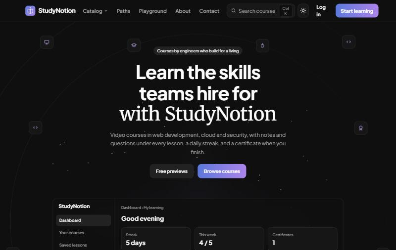
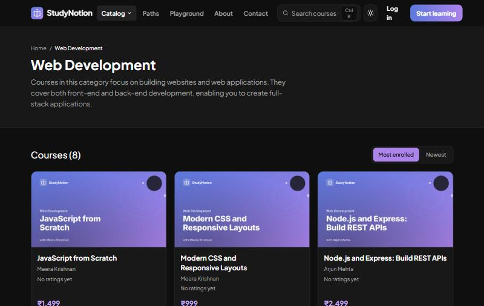
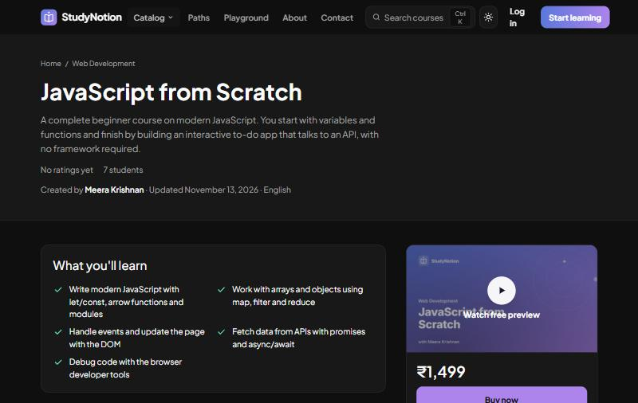
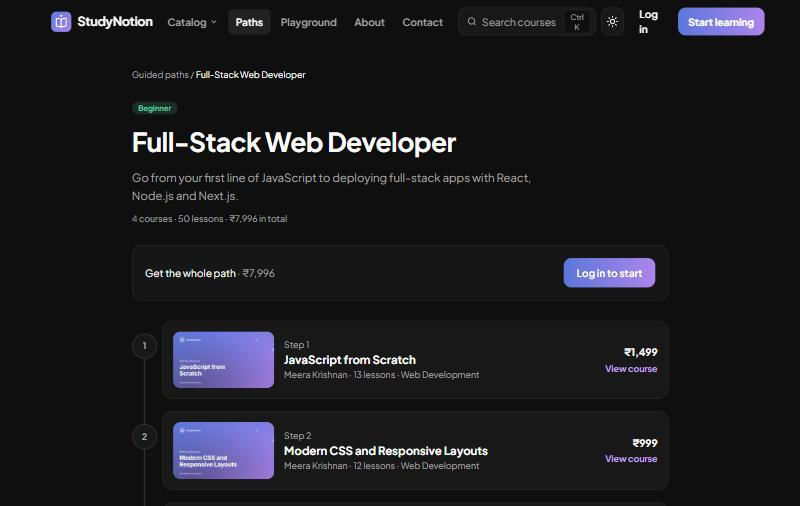
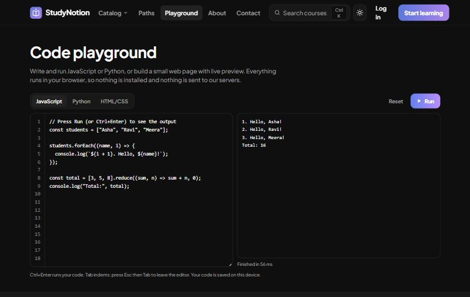
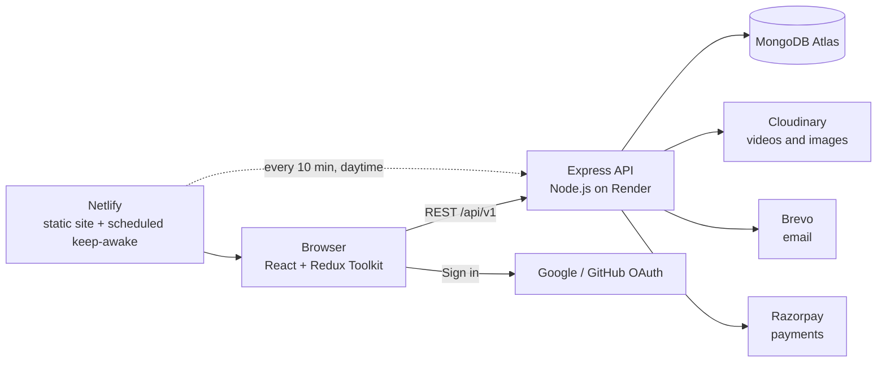

# StudyNotion

An online learning platform where instructors publish video courses and students buy them, learn at their own pace and earn certificates. It's built with the MERN stack: MongoDB, Express, React and Node.js.

**Live site:** https://studynotion-project-1.netlify.app

To look around without signing up, open **Log in** and choose **Try as student**, **Try as instructor** or **Try as admin**. Demo accounts are read-only. The first visit after a quiet spell can take up to a minute while the free server wakes up.



## Features

### For students
- Browse subjects, filter courses by price and length, and search everything with <kbd>Ctrl</kbd>+<kbd>K</kbd>
- Watch free preview lessons, then buy with Razorpay (test mode), with coupons and a cart
- A lesson player with notes, saved lessons, a Q&A thread under every lesson and section quizzes
- Pick up where you left off on any device
- A daily learning streak, a weekly goal and a Sunday reminder email (which you can turn off)
- A certificate for every finished course, with a public link anyone can use to check it's genuine
- Guided paths that order courses into a roadmap, such as Full-Stack Web Developer
- A code playground for JavaScript, Python and HTML/CSS that runs in the browser
- Receipts and refund receipts for every purchase

### For instructors
- A course builder for sections, lessons, video upload, pricing and publishing for review
- Course stats, student progress, review replies, announcements, coupons and quizzes

### For admins
- An overview of revenue, orders and sign-ups, with charts and table views
- Course review (approve or request changes), users (suspend or reactivate), purchases (refund), reviews (hide), subjects, guided paths, an activity log and CSV exports

### Across the app
- Sign in with email (verified with a one-time code), Google or GitHub
- Light and dark themes
- In-app notifications
- Responsive and keyboard-accessible

| Catalogue | Course page |
|---|---|
|  |  |
| **Guided path** | **Code playground** |
|  |  |

## Architecture



- **Frontend** (`src/`): React 18, Vite, Redux Toolkit, React Router, Tailwind CSS with theme tokens as CSS variables. It's hosted on Netlify, which also runs a scheduled function that keeps the free API awake during the day.
- **Backend** (`server/`): Express and Mongoose, hosted on Render. Authentication uses JWTs (in an httpOnly cookie or a bearer header), with role middleware (Student, Instructor, Admin), course-ownership checks, rate limiting on sign-in and email endpoints, and security headers.
- **Email**: sent through Brevo's HTTPS API, because Render's free plan blocks SMTP.
- **Payments**: Razorpay orders are verified on the server with the signature, and receipts are rebuilt from Razorpay if any are missing.

## Project structure

```
src/                     React app
  pages/                 Route-level pages
  components/core/       Feature components (Dashboard, Course, Auth, ViewCourse…)
  components/common/     Shared UI (Navbar, Footer, Playground, modals)
  services/              API endpoints and request helpers
  slices/                Redux state
server/                  Express API
  controllers/  models/  routes/  middlewares/  utils/  mail/templates/
  seed/                  Demo catalogue (SEED_DEMO=add|remove)
  tests/                 Server tests (node tests/index.js)
e2e/                     Playwright browser tests
netlify/functions/       Scheduled keep-awake ping
```

## Running locally

You'll need Node.js 20 or later, plus a MongoDB database (local or Atlas).

```sh
git clone https://github.com/Anandkanil/Study-Notion-Project.git
cd Study-Notion-Project
npm install
cd server && npm install && cd ..
```

Create `.env` in the project root:

```
REACT_APP_BASEURL=http://localhost:4000/api/v1
REACT_APP_RAZORPAY=<Razorpay key id, test mode>
```

Create `server/.env`:

```
MONGODB_URL=<MongoDB connection string>
JWT_SECRET=<a long random string>
FRONTEND_URL=http://localhost:3000
CLOUDINARY_CLOUD_NAME=…  CLOUDINARY_API_KEY=…  CLOUDINARY_API_SECRET=…  FOLDER_NAME=StudyNotion
RAZORPAY_KEY_ID=…  RAZORPAY_KEY_SECRET=…
BREVO_API_KEY=…  MAIL_FROM=<verified sender address>
# Optional: GOOGLE_CLIENT_ID, GITHUB_CLIENT_ID, GITHUB_CLIENT_SECRET, CONTACT_EMAIL, ALERT_EMAIL
```

Then start both apps:

```sh
npm run dev:all        # client on http://localhost:3000, API on http://localhost:4000
```

To fill an empty database with the demo catalogue (8 instructors, 24 courses, 36 students and 5 paths, all on reserved `.test` email addresses), start the server once with `SEED_DEMO=add`.

## Tests

```sh
cd server && npm test        # server tests, using fake models: no database needed
npm run build && npm run test:e2e   # browser smoke tests (needs: npx playwright install chromium)
```

Both suites run on every pull request in GitHub Actions. Netlify builds a preview for each pull request.

## Author

Anand K Anil
